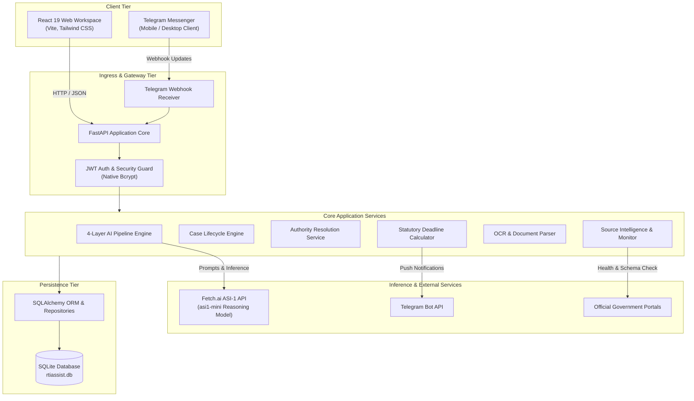
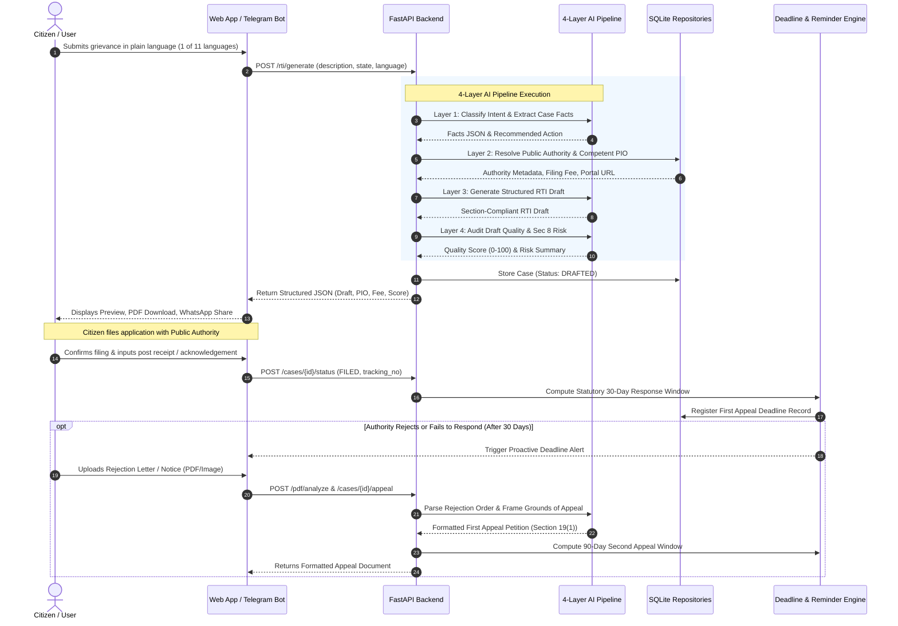
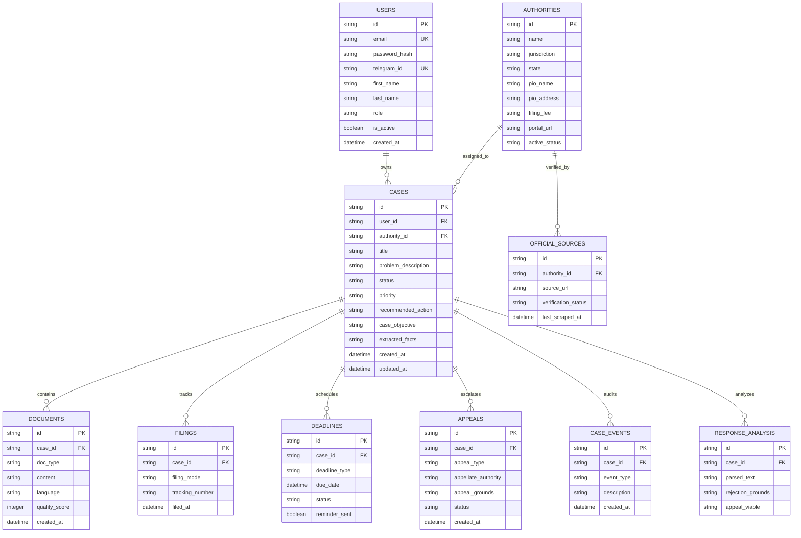

<div align="center">


### RTIAssist: AI-Powered RTI, Legal Tools and Case Lifecycle Platform

[Live Demo](https://shlok926.github.io/rtiassist-api) | [API Docs](#api-reference) | [Telegram Bot](#telegram-bot-integration) | [Quick Start](#quick-start) | [Contributing](CONTRIBUTING.md) | [Changelog](CHANGELOG.md)

[](https://python.org)
[](https://fastapi.tiangolo.com)
[](https://asi1.ai)
[](src/)
[](tests/)
[](Dockerfile)
[](LICENSE.md)

> India's legal-tech platform for automated Right to Information (RTI) drafting, Public Information Officer (PIO) authority resolution, statutory deadline tracking, and appeal generation.

Detailed product specifications and RTI guide: [Product Overview and Legal Guide](docs/RTI_PRODUCT_OVERVIEW.md)

</div>

---

## Overview

Over 65 million RTI applications are filed annually across India. Citizens and advocacy groups face systemic bottlenecks when exercising their rights under the RTI Act, 2005:

- **Public Authority Identification**: Identifying whether an issue falls under Central, State, or Municipal jurisdiction, and locating the competent PIO.
- **Statutory Drafting Requirements**: Applications must formulate clear questions and request specific records without requesting opinions or attracting Section 8 exemptions.
- **Language Barriers**: Legal portals and forms frequently restrict communication to formal Hindi or English.
- **Strict Appeal Timelines**: Citizens regularly forfeit rights due to unmonitored statutory deadlines (30-day First Appeal under Section 19(1) and 90-day Second Appeal under Section 19(3)).
- **Arbitrary Rejections**: Citizens lack accessible legal tools to analyze denial orders and challenge non-disclosure.

RTIAssist automates this entire lifecycle in 11 Indian languages, from problem definition to final statutory appeal.

---

## System Architecture

The following diagram illustrates the multi-tier system architecture:



---

## Live End-to-End Workflow

The sequence below illustrates the live lifecycle of a citizen query from submission through draft generation, filing, and statutory appeal escalation:



---

## Database Architecture

The entity-relationship model enforces strict user case isolation, lifecycle tracking, public authority registries, and statutory deadlines:



---

## Core Capabilities

- **4-Layer AI Pipeline**:
  - *Layer 1 (Intent)*: Determines whether RTI, Consumer Forum, Labour Court, or Grievance Portal is the appropriate legal mechanism.
  - *Layer 2 (PIO Resolver)*: Matches query context against 700+ Central and State authority departments.
  - *Layer 3 (Drafter)*: Assembles questions adhering to Section 6(1) drafting principles without requesting opinions.
  - *Layer 4 (Quality Scorer)*: Evaluates risk against Section 8 exemption clauses (defense, trade secrets, personal privacy) and assigns a score from 0 to 100.
- **Language Support**: Native drafting across 11 languages: English, Hindi, Tamil, Telugu, Kannada, Bengali, Gujarati, Marathi, Punjabi, Malayalam, and Odia.
- **End-to-End Case Progression**: Full tracking across states: `UNDERSTANDING` -> `DRAFTED` -> `FILED` -> `PENDING_RESPONSE` -> `FIRST_APPEAL` -> `SECOND_APPEAL`.
- **OCR and Rejection Parsing**: Upload rejection notices to isolate specific rejection clauses cited by authorities and auto-populate appeal templates.
- **Proactive Deadline Alerts**: Real-time statutory deadline monitoring with push alerts at 7 days and 1 day prior to expiry.
- **Enterprise Security**: Native `bcrypt` password hashing, token-based JWT authentication, rate limiting, and case data isolation.

---

## Tech Stack

| Layer | Component | Description |
|---|---|---|
| **Frontend** | React 19, Vite 8, Tailwind CSS | Client workspace with responsive forms and document export |
| **Backend** | FastAPI, Python 3.10+, Uvicorn | High-concurrency async REST API and webhook endpoints |
| **AI Inference** | Fetch.ai ASI-1 API (`asi1-mini`) | High-speed LLM reasoning pipeline |
| **Data & ORM** | SQLAlchemy, SQLite, Alembic | Relational storage with repository abstraction |
| **Security** | Native Bcrypt, PyJWT | Cryptographic password verification and bearer authentication |
| **OCR & Parsing**| `pdfplumber`, PyPDFium2 | PDF ingestion, text extraction, and clause parsing |
| **Bot Gateway** | `python-telegram-bot` v20 | Webhook-driven interactive Telegram assistant |
| **Testing** | Pytest, Vitest | 117 backend integration tests and frontend component checks |

---

## Quick Start

### Prerequisites
- Python 3.10 or higher
- Node.js 18 or higher with npm
- Git

### 1. Clone and Set Up Backend
```bash
git clone https://github.com/shlok926/rtiassist-api.git
cd rtiassist-api

# Create and activate Python virtual environment
python -m venv venv
venv\Scripts\activate       # On Linux/macOS: source venv/bin/activate

# Install backend dependencies
pip install -r requirements.txt
```

### 2. Set Up Frontend
```bash
npm install
```

### 3. Environment Variables
Copy `.env.example` to `.env`:
```bash
cp .env.example .env
```

Configure the environment variables in `.env`:
```env
ASI1_API_KEY=your_asi1_api_key_here         # Fetch.ai API key from https://asi1.ai
TELEGRAM_TOKEN=your_telegram_bot_token       # Telegram token from @BotFather (optional)
JWT_SECRET=your_secure_random_key_here
DATABASE_URL=sqlite:///./rtiassist.db
```

### 4. Run Development Servers

**Run FastAPI Backend:**
```bash
uvicorn main:app --reload --port 8000
```
API documentation is available at `http://localhost:8000/docs`.

**Run React Frontend:**
```bash
npm run dev
```
Client workspace is available at `http://localhost:5173`.

---

## Testing

Run test suites across backend and frontend:

```bash
# Execute backend test suite (117 test cases)
pytest

# Execute frontend component test suite
npm run test

# Run frontend production build check
npm run build
```

---

## Project Structure

```
rtiassist-api/
├── main.py                     # FastAPI application factory and router configuration
├── app.py                      # Alternative entry point for Hugging Face Spaces
├── start.sh                    # Container boot script
├── Dockerfile                  # Container definition
├── render.yaml                 # Render cloud deployment blueprint
├── requirements.txt            # Python dependencies
├── package.json                # Frontend dependencies and scripts
│
├── agents/                     # 4-Layer AI Pipeline
│   ├── intent_classifier.py    # Problem classification and legal mechanism routing
│   ├── pio_resolver.py         # Authority identification and directory resolution
│   ├── draft_generator.py      # Statutory RTI application draft generation
│   └── quality_checker.py      # Section 8 exemption risk analysis and quality score
│
├── routes/                     # REST API route handlers
│   ├── auth.py                 # User authentication (register, login, JWT)
│   ├── cases.py                # Case tracking, status changes, appeal triggers
│   ├── authorities.py          # Authority search and directory lookup
│   ├── admin_authorities.py    # Public authority management endpoints
│   ├── rti.py                  # Direct RTI generation endpoint
│   ├── legal.py                # Legal tools (Consumer, Labour, Legal Notice, Second Appeal)
│   └── pdf_analysis.py         # OCR upload and rejection letter parser
│
├── services/                   # Core business logic layer
│   ├── case_service.py         # Case state management and validation
│   ├── appeal_service.py       # First and Second Appeal petition generation
│   ├── authority_service.py    # Jurisdiction and fee calculation
│   ├── source_monitoring.py    # Scheduled authority status scraping
│   ├── ocr_service.py          # PDF extraction and rejection parsing
│   └── deadline_service.py     # 30-day and 90-day statutory timeline calculation
│
├── repositories/               # Data access layer
│   ├── user_repository.py      # User authentication queries
│   ├── case_repository.py      # Case storage and event logging
│   └── authority_repository.py # Authority data access
│
├── integrations/
│   └── telegram/               # Telegram bot implementation (Webhook mode)
│       ├── bot.py              # Application builder and handler wiring
│       ├── handlers.py         # Interactive commands (/start, /newcase, /cases)
│       └── identity.py         # Telegram ID to RTIAssist user mapping
│
├── src/                        # React 19 Frontend
│   ├── App.jsx                 # Citizen workspace shell
│   ├── components/             # Reusable UI modules (RTI, Legal, Tracker, Auth)
│   └── context/                # Client state management
│
├── docs/                       # Project documentation
│   ├── RTI_PRODUCT_OVERVIEW.md # Comprehensive RTI legal guide
│   ├── DESIGN_AND_TECH_STACK.md# System architecture deep-dive
│   └── DEPLOYMENT.md           # Cloud deployment instructions
│
└── tests/                      # Automated test suite (117 test cases)
    ├── test_auth.py            # Password hashing and token validation
    ├── test_cases.py           # Case state and appeal transitions
    ├── test_authorities.py     # Authority lookup tests
    ├── test_web_telegram_parity.py # Web-to-Telegram feature parity
    └── frontend/               # Vitest component test cases
```

---

## API Reference

Interactive Swagger documentation is available at `/docs` when the backend is running.

### Core Endpoints

| Category | Method | Endpoint | Description |
|---|---|---|---|
| **Authentication** | `POST` | `/auth/register` | Register user with bcrypt password hash |
| **Authentication** | `POST` | `/auth/token` | Authenticate and obtain JWT bearer token |
| **RTI Generator** | `POST` | `/rti/generate` | Generate RTI draft and PIO metadata via AI pipeline |
| **Case Lifecycle** | `POST` | `/cases/` | Create and store a new case record |
| **Case Lifecycle** | `GET` | `/cases/` | Fetch all cases belonging to authenticated user |
| **Case Lifecycle** | `POST` | `/cases/{id}/appeal` | Generate First or Second Appeal from existing case |
| **Authorities** | `GET` | `/authorities/search` | Search 700+ Public Authorities across India |
| **OCR Analysis** | `POST` | `/pdf/analyze` | Ingest rejection notice and extract grounds of appeal |
| **Legal Tools** | `POST` | `/legal/consumer-complaint` | Generate Consumer Protection Court petition |
| **Legal Tools** | `POST` | `/legal/legal-notice` | Generate formal demand notice |
| **Legal Tools** | `POST` | `/legal/labour-complaint` | Generate Labour Commission complaint |

---

## Telegram Bot Integration

The Telegram Bot operates in webhook mode alongside the FastAPI server:

- **Command Menu**:
  - `/start`: Select language and initiate case creation.
  - `/newcase`: Begin plain-language complaint ingestion.
  - `/cases`: View active cases and statutory countdowns.
  - `/help`: Detailed instructions for filing and statutory requirements.
- **Automated Deadline Notifications**: Direct messages sent 7 days and 1 day prior to First Appeal deadline expiry.

---

## Development Milestones

- **Phases 1 to 11**: 4-Layer AI Pipeline, prompt engineering, 11 Indian languages, and bot integration.
- **Phase 12**: Security architecture audit and production readiness hardening.
- **Phase 13**: Real-world case intelligence, fact extraction, and response mapping.
- **Phase 14**: React 19 citizen workspace and central UI integration.
- **Phase 15**: Scheduled source monitoring, authority seeding, and product hardening.
- **Phase 16**: Final production audit, native `bcrypt` migration, and web-telegram parity validation.

Historical release notes and phase milestones are documented in [`CHANGELOG.md`](CHANGELOG.md).

---

## Contributing

Contributions are welcome. Please refer to [CONTRIBUTING.md](CONTRIBUTING.md) for local setup instructions, code standards, and pull request guidelines.

---

## License

This project is licensed under the MIT License. See [LICENSE.md](LICENSE.md) for full terms.
